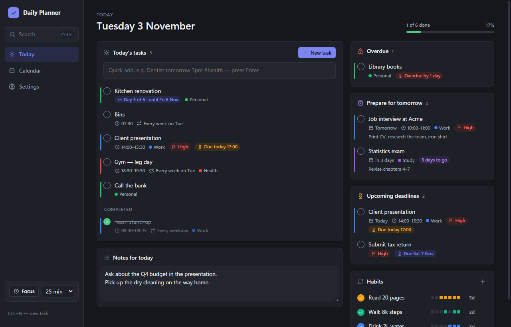
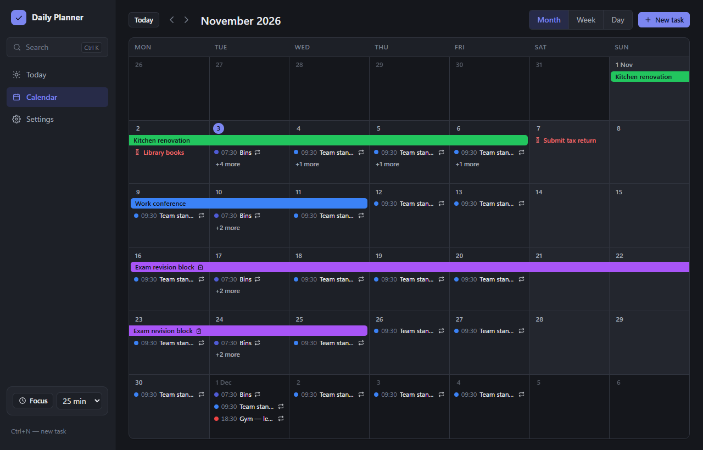
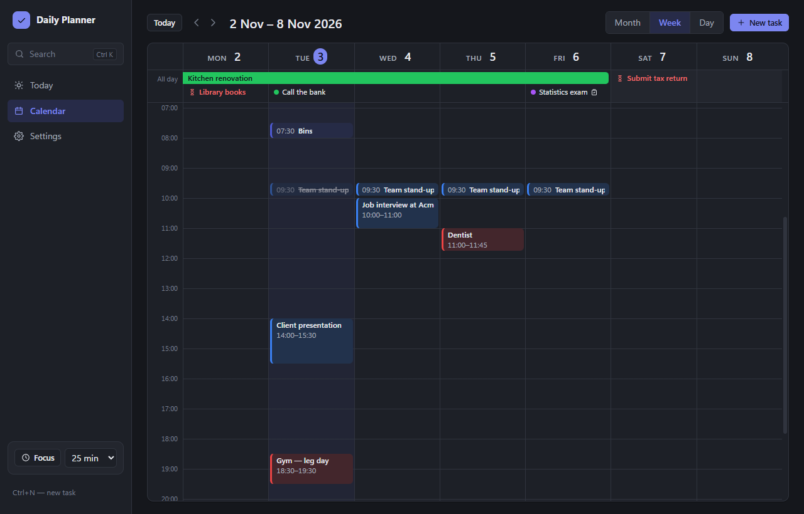
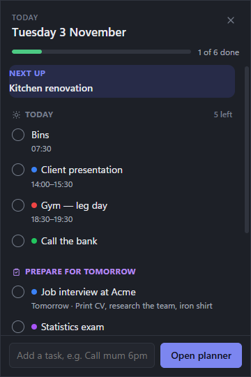

# Daily Planner

A desktop daily planner for Windows: today's tasks, a calendar with multi-day projects, upcoming deadlines, preparation reminders and a summary pop-up in the system tray. It starts with Windows and runs quietly in the tray (under the taskbar's **^** "show hidden icons" arrow). Your data stays on your PC.

Built with [Tauri 2](https://tauri.app) (Rust) and React + TypeScript, with a local SQLite database.



## Features

**Planning**
- **Today view:** today's tasks with progress, overdue items, upcoming deadlines (next 7 days), **Prepare for tomorrow**, undated tasks, a daily note and habits.
- **Task requires preparation:** tick it on any task, add what needs preparing, and choose how many days ahead to start. The task then appears in *Prepare for tomorrow* and in an evening reminder until you mark the preparation done.
- **Tasks:** time and duration, deadline (with optional time), priority, category, notes and subtasks.
- **Multi-day projects:** shown in the calendar as one continuous bar from the start date to the end date.
- **Repeating tasks:** daily, weekdays, weekly on chosen days, monthly or yearly, every N days, weeks, months or years, optionally until a date. When you edit one you choose "this task" or "this and later ones".
- **Quick add in plain words:** for example `Dentist tomorrow 3pm for 45m #health !high +prep` or `Bins every monday`.
- **Unfinished tasks:** tasks from earlier days that weren't ticked off can be moved to today in one click.
- **Habits:** a daily tick, a streak and the last 7 days. There's also a **focus timer** (Pomodoro) and **search** (Ctrl+K).

**Calendar**
- Month, week and day views.
- Drag a task or project to move it, drag either end of a bar to change its dates, and drag a timed task's bottom edge to change its length.
- Deadline markers. Overlapping items stack in separate lanes, and a busy day shows "+N more".



**Windows integration**
- A tray icon with a summary pop-up: today's progress, what's next, what to prepare and deadlines. You can tick tasks off and quick-add from it.
- Starts with Windows (quietly, in the tray). Closing the window keeps it running in the tray.
- Notifications before tasks start and before deadlines, an evening preparation reminder and a morning summary. Each can be adjusted in Settings.

| Week view | Tray pop-up |
|---|---|
|  |  |

**Your data**
- Stored locally in `%APPDATA%\com.dailyplanner.app\planner.db`.
- Automatic daily backups (the last 14 are kept), plus backup to and restore from a single `.json` file.
- Export to `.ics` for Google Calendar, Outlook or Apple Calendar.
- Light and dark themes, and weeks starting on Monday or Sunday.

## Install

Download **`DailyPlanner_<version>_x64-setup.exe`** from the [latest release](https://github.com/NMalkovCode/daily-planner/releases/latest) and run it. It installs for the current user only (no admin rights needed), into `%LOCALAPPDATA%\Daily Planner`, and adds Start menu and desktop shortcuts. Uninstall it from **Settings → Apps → Installed apps**.

The installer isn't code-signed yet, so Windows may show "Windows protected your PC". Click **More info → Run anyway**. Requires Windows 10 or 11 (64-bit).

## Build from source

Prerequisites (Windows):
- [Node.js](https://nodejs.org) LTS
- [Rust](https://rustup.rs) (stable, MSVC toolchain)
- Microsoft C++ Build Tools ("Desktop development with C++")
- WebView2, which is already part of Windows 11

```bash
npm install
npm run tauri dev      # run with live reload
npm run tauri build    # build the exe and installer
```

The build produces:
- `src-tauri/target/release/DailyPlanner.exe`: the app itself
- `src-tauri/target/release/bundle/nsis/Daily Planner_<version>_x64-setup.exe`: the installer

### Tests

```bash
npm test                              # front end: calendar layout, quick add, repeat rules
cd src-tauri && cargo test --lib      # Rust: database, repeats, reminders, backups
```

For testing, the `DAILY_PLANNER_DB` environment variable points the app at a different database file, so your real data stays untouched.

## Project layout

```
src/                    React front end
  views/                Today, Calendar, Settings
  components/           task editor, task rows, calendar rows and time grid, focus timer, search
  overlay/              tray summary pop-up
  lib/                  API wrapper, dates, calendar layout, quick-add parser, repeat rules
src-tauri/              Rust back end
  src/db/               SQLite schema and queries: tasks, repeats, habits, notes, backups
  src/reminders.rs      notification scheduler
  src/shell.rs          tray icon, pop-up window, start with Windows
  windows/hooks.nsh     installer step that removes the startup entry on uninstall
PLAN.md                 the original plan and build phases
```

## Roadmap

- macOS version (built on a Mac or with GitHub Actions; needs an Apple Developer account to sign it)
- Weekly review
- Google / Outlook calendar sync
- Signed installer and automatic updates
